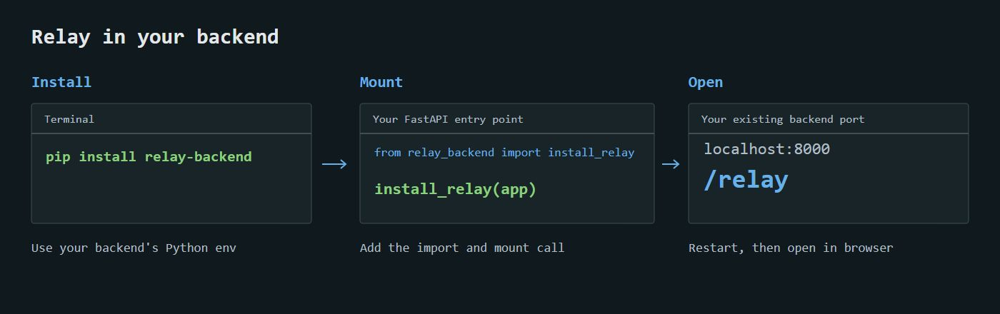

# Relay documentation

[API testing workflow](API-TESTING.md) covers discovery, authorization, requests, responses and exports.

Relay ships as **relay-backend**, importing **relay_backend**. Python v0.0.4 is published on PyPI and its distributions are attached to the GitHub release. The Node v0.0.4 tarball is attached there too; npm remains at 0.0.3 while account authentication for the upload is pending. The complete UI is bundled; consumers do not clone or build this repository.



## Quick start

Install in your backend's Python environment:

```sh
python -m pip install relay-backend
```

In the file where `app = FastAPI()` is created:

```python
from relay_backend import install_relay
install_relay(app)
```

Restart your backend normally. Open `/relay` on its existing port. That is all the required configuration.

## Node backends

The [relay-backend npm package](https://www.npmjs.com/package/relay-backend) is published for Express, Fastify and Node HTTP. The UI is bundled; Python is not needed. See [Node integration](NODE.md) for JavaScript and TypeScript setup.

## Guides

New in the 0.0.4 source: [guided setup and diagnostics](SETUP.md), local endpoint notes/activity and persistent contract-change explanations.

1. [FastAPI integration](FASTAPI.md): installation, existing apps, factories, development flags, Socket.IO and optional settings.
2. [Testing APIs](TESTING.md): inputs, shared and endpoint auth, responses, limits and shortcuts.
3. [Git workflow](GIT.md): statuses, source authors, commit/pull sharing and conflicts.
4. [Exports](EXPORTS.md): Relay reports, JSON, saved responses and file associations.
5. [Troubleshooting](TROUBLESHOOTING.md): missing `/relay`, installation, auth, schemas and reports.

For maintainers: [v0.0.4 plan](RELEASE-0.0.4.md), [contributor setup](CONTRIBUTING.md), [release process](RELEASING.md), [architecture](ARCHITECTURE.md), [distribution](DISTRIBUTION.md) and [changelog](../CHANGELOG.md).

Python 3.11+ is required. This is a local development tool: loopback clients/hosts only. Native execution runs real backend handlers and can modify development data. There is no Relay cloud or editable endpoint definition. Optional automatic team status sync exchanges status metadata on a separate Git branch. Done is a manual team status, not test/security approval.
