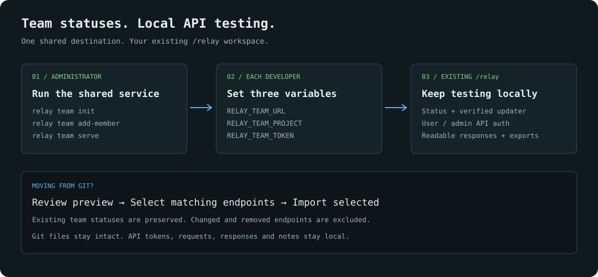

# Realtime team statuses

A developer changes the status beside an API; teammates see the update and its author without Git commands or a status branch. API testing stays on each developer's local backend.



## One-time team setup

An administrator needs Python 3.11+ on the shared service host. No repository clone or frontend build is required:

```sh
python -m pip install --upgrade "relay-backend[realtime]"
relay team init --config ./members.json --project my-backend --name Alice
relay team serve --config ./members.json --database ./team.sqlite3
```

`init` prints a private developer token once and saves only its hash. Keep the membership file and database outside your code repository. The service listens on loopback port 4490. For teammates on other machines, expose it through your host's HTTPS reverse proxy; keep the service process and persistent storage running.

Give each developer a separate credential:

```sh
relay team add-member --config ./members.json --project my-backend --name Bob
```

Restart the service after membership changes. Use `--role reader` for developers who may inspect statuses and test APIs but cannot change team statuses. Share each printed credential only with that developer, and back up membership/database files privately. If credentials are lost, rotate membership rather than attempting to recover the plaintext token.

## Connect an existing backend

Realtime team sync is included in 0.0.5. Upgrade the package in the existing backend environment:

```sh
# FastAPI / Python
python -m pip install --upgrade "relay-backend[realtime]"

# JavaScript / TypeScript
npm install relay-backend@latest
```

Node includes its Socket.IO client dependency. Python's optional realtime extra also supports running the shared service. Keep the existing `install_relay(app)` or `relay({openapi: generatedSchema})` integration. Configure these three backend environment variables:

| Variable | Value |
| --- | --- |
| `RELAY_TEAM_URL` | HTTPS origin of the shared service; HTTP is accepted only on loopback for development. No URL credentials, query strings or path prefixes. |
| `RELAY_TEAM_PROJECT` | Project ID provisioned by the service administrator. |
| `RELAY_TEAM_TOKEN` | This developer's collaboration credential, supplied privately by the administrator. |

Restart the backend and open its existing `/relay/` page. The environment variables select realtime mode automatically. The shared service must already be running; the [service setup](../apps/team-service/README.md) is performed once by the team administrator. There is no second local runner to launch and no browser configuration containing the collaboration token.

For explicit application configuration, Python accepts `install_relay(app, status_mode="realtime", realtime={"url": service_origin, "project": project_id, "token": developer_token})`; Node accepts `relay({openapi: generatedSchema, statusMode:"realtime", realtime:{url:serviceOrigin, project:projectId, token:developerToken}})`. Load values from private configuration rather than committing tokens. The Fastify adapter accepts the same Node options.

Choose `status_mode="local"` / `statusMode:"local"` to disable sharing, or `"git"` to explicitly use the existing Git sync workflow. Existing `sync_status=True` / `syncStatus:true` remains supported for Git sync. Enabling Git and realtime together is rejected. Realtime mode does not write Git status metadata or create a status branch. Source attribution still comes from the application's repository.

The local backend holds an authenticated Socket.IO connection. Only endpoint status, contract fingerprint and revision are sent. The browser continues using same-origin local companion routes and checks team metadata every second while visible, preserving open operations, auth drafts and captured responses. Browser status changes submit the revision actually displayed; stale changes show the accepted peer status and a review message, without automatic resubmission. The service assigns the updater identity and timestamp.

An acknowledged status cache survives backend restart and is scoped by service origin and project. Developer tokens are never written to that cache or sent to the browser. Connection, offline and conflict states are visible. Read-only membership is shown explicitly and disables status editing while leaving API testing available. If the service is unavailable, API execution and local notes still work; status writes are rejected rather than queued for an unexpected later overwrite. Reconnect fetches an authoritative snapshot and recovers missed changes. API-testing bearer tokens, bodies, responses and local notes remain local.

## Import existing Git statuses

1. While still using Git sync, let its last refresh finish. Keep `.relay/status.json` as your rollback source.
2. Stop each backend. Remove `sync_status=True` / `syncStatus:true` or explicit `"git"` mode before adding the realtime environment variables. Do this for all developers so Git and realtime do not become competing authorities.
3. Upgrade the package, set the three private variables, then restart normally. Existing request testing, local notes and workspace data remain available.
4. In `/relay/`, click **Import Git statuses**. Review the previous Git author, endpoint and status. Select only the endpoints you want, then click **Import selected**.

Only active endpoints with matching contract fingerprints and no existing team record are eligible. Removed/changed endpoints and existing team statuses are shown with an explanation and cannot be selected. Nothing uploads just by switching modes or opening the preview. A changed preview is rejected; concurrent edits stop the import without overwriting the accepted team status. A partially completed import reports the endpoints acknowledged before it stopped. Refresh the preview before continuing; already-imported endpoints are excluded.

The service records the authenticated importer and a new timestamp. The preview's old Git author is historical context, not a claim of authenticated service authorship. Git status files and branches are not modified or deleted. Local notes, tokens, request bodies and responses are excluded from imports.

## Upgrade and rollback

Restart the backend after any package upgrade. Existing `install_relay(app)`, Express/Node middleware and Fastify plugin calls remain valid. Plain local testing needs no service or new settings. Legacy Python `relay_agent` root imports remain compatible.

The upgrade gate installs published Python 0.0.4 and npm 0.0.3 first, saves real workspace notes/statuses, upgrades those installations in place and verifies native discovery, separate user/admin authorization, execution, bundled branding and retained workspace data. Realtime consumer checks then verify both runtimes against one service with conflict rejection, durable restart and offline API execution.

To stop realtime sharing, stop the backend, remove the team environment variables and select `status_mode="local"` / `statusMode:"local"`. The previous local workspace remains available. Returning to Git uses its retained status file, not a reverse import of newer team statuses. Review differences before re-enabling Git sync. Do not delete the service database or Git status source as part of rollback.

## Privacy and service boundaries

Only endpoint ID, contract fingerprint, progress, revision and service-assigned identity/timestamp travel through the team service. API requests, credentials, local notes, drafts and captured responses remain local. Export files can contain sensitive API responses; review those separately before sharing.

The initial service uses an explicit administrator-managed developer allowlist, one process and persistent SQLite storage. Repository access alone does not grant team-service access. Use HTTPS for remote access. See [service operations and protocol](../apps/team-service/README.md) for membership changes, backups and deployment limits.
