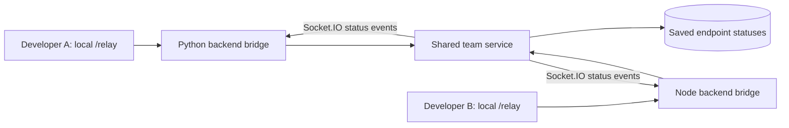

# Shared team statuses: v0.0.5 development

The optional [shared service foundation](../apps/team-service/README.md) now implements authenticated HTTP snapshots, writer/reader membership, durable SQLite records, revision-checked updates and project-scoped Socket.IO notifications. Python and Node transport consumers are verified independently. It is not part of the published 0.0.4 packages; native bridges and local connection/conflict UI are implemented in source; reviewed migration and release verification remain pending.

Target launch: **November 2026**, after v0.0.4. The [README roadmap](../README.md#release-roadmap) defines weekly milestones and launch gates. The [v0.0.4 plan](RELEASE-0.0.4.md) keeps setup and local handoff improvements independent of this service.

The goal is simple: a developer changes the status beside an API; the other developers see the change and its author without Git commands or a status branch. API testing remains the main workspace.

## Proposed flow

Each local Relay integration connects to the same authenticated team service. The service persists endpoint status, contract fingerprint, authenticated updater and timestamp, then broadcasts an update to that project's members. Socket.IO provides project rooms and connection middleware; it does not replace durable storage. See its [server API](https://socket.io/docs/v4/server-api/).

Local API requests, bearer tokens, request bodies and captured responses stay in the developer's testing environment. Only team status metadata goes to the shared service. A backend bridge can preserve the local browser's existing same-origin flow.

## Scope and implementation sequence

1. Decide the service deployment/storage model, self-hosting setup, identity provider and project access rules. Document configuration before implementation.
2. Define a shared protocol for Python and Node: project/endpoint identity, contract fingerprint, status, authenticated updater, server timestamp and monotonic revision. Mutations include the expected revision; stale updates receive a conflict response.
3. Implement authenticated membership checks before room subscription, reads and writes, plus durable transactional updates. The service assigns actor/timestamp/revision; client-supplied Git names do not establish identity.
4. Bridge local integrations to the service, keeping the browser's existing same-origin request execution. Distinguish local API authorization from developer collaboration sign-in.
5. Recover full state or a validated revision gap after reconnect. Surface unacknowledged edits and conflicts; do not silently overwrite another developer's accepted update.
6. Select local, Git or realtime mode explicitly. Preview imports from existing Git status metadata; do not run competing status authorities or create a Git status branch in realtime mode.
7. Dogfood, verify both package upgrades and publish only after the release requirements below pass.

Local notes/activity remain local for this release. Remote request execution, payload sharing, chat, OAuth API-testing flows and multipart uploads are not part of this milestone.

## Contributor access

Use an authenticated developer identity with repository collaborator/team checks, or an explicit developer allowlist. A Git-configured name alone does not authenticate someone. For public repositories, being able to clone the code does not imply permission to change team statuses.

## Release requirements

- Minimal setup: one shared service address and developer sign-in, or a verified host-backend authentication adapter.
- Durable status storage with project isolation and membership enforcement.
- Server acknowledgements and explicit conflict handling for simultaneous edits.
- Full state recovery after reconnect, including changes missed while offline.
- API testing stays usable when collaboration is unavailable; sync failure is visible.
- Verify two separate developer environments, unauthorized clients, reconnects and concurrent updates before shipping.

Independent localhost servers need a shared destination to communicate. Adding Socket.IO to each local server alone does not connect the team. The implementation should make that shared destination easy to configure and avoid creating a Git status branch in this mode.

## Native integrations (0.0.5 development)

The Python and Node bridges are implemented in the source tree and verified together against the shared service. This support is **not available in the currently published 0.0.4 Python or 0.0.3 npm packages**. The following setup describes the forthcoming release; maintainers verify built wheel/tarball artifacts before publishing it.

Python users will install `relay-backend[realtime]`; Node users will install `relay-backend`, which includes its Socket.IO client dependency. Keep the existing `install_relay(app)` or `relay({openapi: generatedSchema})` integration. Configure these three backend environment variables:

| Variable | Value |
| --- | --- |
| `RELAY_TEAM_URL` | HTTPS origin of the shared service; HTTP is accepted only on loopback for development. No URL credentials, query strings or path prefixes. |
| `RELAY_TEAM_PROJECT` | Project ID provisioned by the service administrator. |
| `RELAY_TEAM_TOKEN` | This developer's collaboration credential, supplied privately by the administrator. |

Restart the backend and open its existing `/relay/` page. The environment variables select realtime mode automatically. The shared service must already be running; the [service setup](../apps/team-service/README.md) is performed once by the team administrator. There is no second local runner to launch and no browser configuration containing the collaboration token.

For explicit application configuration, Python accepts `install_relay(app, status_mode="realtime", realtime={"url": service_origin, "project": project_id, "token": developer_token})`; Node accepts `relay({openapi: generatedSchema, statusMode:"realtime", realtime:{url:serviceOrigin, project:projectId, token:developerToken}})`. Load values from private configuration rather than committing tokens. The Fastify adapter accepts the same Node options.

Choose `status_mode="local"` / `statusMode:"local"` to disable sharing, or `"git"` to explicitly use the existing Git sync workflow. Existing `sync_status=True` / `syncStatus:true` remains supported for Git sync. Enabling Git and realtime together is rejected. Realtime mode does not write Git status metadata or create a status branch. Source attribution still comes from the application's repository.

The local backend holds an authenticated Socket.IO connection. Only endpoint status, contract fingerprint and revision are sent. The browser continues using same-origin local companion routes and checks team metadata every second while visible, preserving open operations, auth drafts and captured responses. Browser status changes submit the revision actually displayed; stale changes show the accepted peer status and a review message, without automatic resubmission. The service assigns the updater identity and timestamp.

An acknowledged status cache survives backend restart and is scoped by service origin and project. Developer tokens are never written to that cache or sent to the browser. Connection, offline and conflict states are visible. Read-only membership is shown explicitly and disables status editing while leaving API testing available. If the service is unavailable, API execution and local notes still work; status writes are rejected rather than queued for an unexpected later overwrite. Reconnect fetches an authoritative snapshot and recovers missed changes. API-testing bearer tokens, bodies, responses and local notes remain local.

Switching from Git does not automatically upload old Git statuses. Reviewed migration and complete upgrade/browser release verification remain separate gates before 0.0.5 ships.
