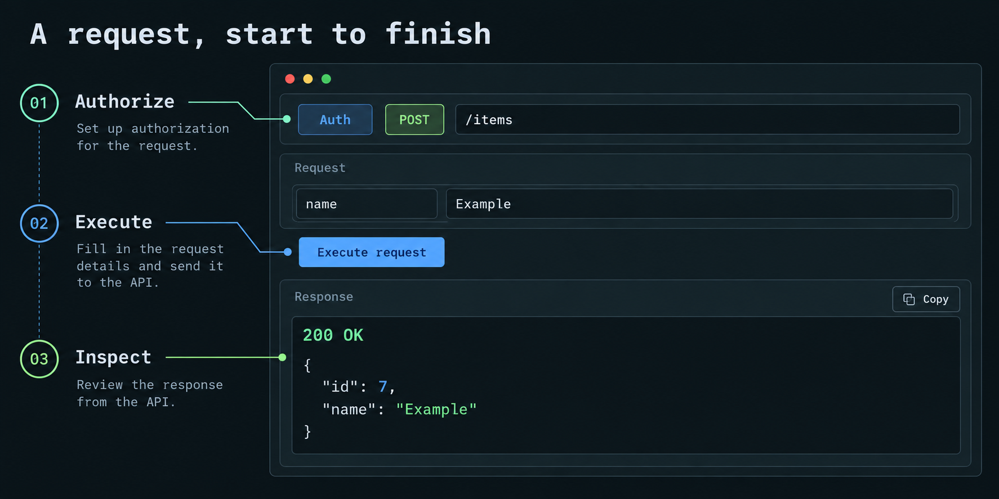
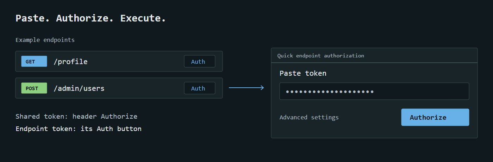

# Testing APIs

## Find and execute

Endpoints are read-only definitions from OpenAPI, grouped by their first tag. Search matches method/path/summary/category; method and status filters narrow results. Open all/Close all controls visible categories, and APIs expand inline.

Enter path/query/header/cookie values and a request body. Execute request is above the inputs. `/` focuses search; `Ctrl+Enter`/`Cmd+Enter` executes the active endpoint.

Generated fields cover straightforward JSON objects; the JSON editor handles more complex schemas. JSON, text and URL-encoded form bodies are supported. Missing required inputs and invalid JSON are checked before execution. Multipart upload is not supported.

For array query parameters, enter a JSON array such as `["active", "pending"]`. FastAPI's default sends repeated keys (`?tag=active&tag=pending`); explicitly declared comma, space and pipe styles are also supported. Nested objects and body arrays use the JSON editor. Remove an optional property there to omit it, or enter `null` where the schema permits it. Read-only properties are excluded from generated request examples. Clear an optional body completely to send no body; a required body cannot be blank.

Native execution invokes real handlers, middleware, dependencies, validation and startup state. It can change development data. HTTP 401/404/422 responses are inspectable backend responses, not necessarily Relay transport errors.

## Auth

Header Authorize sets shared bearer auth. Paste with or without `Bearer`, then explicitly submit Authorize. Cancel/Escape discards unsubmitted edits.

Endpoint Auth beside status supports distinct admin/user credentials without expanding the API. Use shared auth resets the override. Advanced settings offers Shared bearer, Endpoint bearer, Basic, header API key and None. None suppresses shared auth. Backend permissions remain authoritative; Relay does not grant roles.

Credentials and request drafts remain in session memory across endpoint switches and clear on reload. A token found in a response can be applied with Use as bearer token. OAuth browser authorization flows are out of scope; manually obtained tokens work.

Headers accept JSON string values or `Name: value` lines. Duplicate names/invalid input are rejected. The runner manages Host and transport headers.

The auth line shows the credentials that will be used, including a custom Authorization header. Endpoint overrides do not mutate the shared token. API key auth can accompany an explicitly entered Authorization header. Basic credentials use `username:password`; empty or malformed credentials are rejected before sending.

## Response inspection

The desktop response pane is wider. Focus response makes it full width; Back to request preserves inputs. Narrow screens stack panes. Body formats JSON where possible; Raw keeps captured text. Headers and Request expose metadata. Wrap lines is optional; default unwrapped lines preserve JSON structure.

JSON formatting preserves original numeric values, including integers beyond JavaScript's safe range. Payloads over 200,000 characters stay unformatted to keep inspection responsive. Empty bodies are labeled explicitly; Copy still copies the actual empty body. A failed request or invalid edit preserves the last captured response and its timestamp until a new response arrives.

Copy acts on the selected view. Copy request URL includes entered path/query values. Generated code snippets redact recognizable secrets. Export offers a browser report or structured JSON without executing a request.

Metadata shows status, duration and retained bytes. Requests cap at 1 MiB, response/spec retention at 2 MiB and execution at 20 seconds. Truncation is labeled and carried into exports. Redirects are shown without following; response cookies never become implicit auth on future runs.

When a response is truncated, Copy and Export contain only the retained preview. Relay does not silently fetch or claim to preserve the full body.

## Sync and progress

Sync reloads schema; Auto refresh checks the schema every ten seconds. Team statuses refresh independently when automatic Git sync is enabled. Invalid imports preserve the previous successful contract. FastAPI's schema cache still applies. Done is the default manual status; execution never changes it. A contract change can flag a previously Done API as Needs fixing.

In 0.0.4, schema and team sync states appear separately with last-success times. Schema refresh shows added/changed/removed counts; failed refresh retains the last good contract. Sync team statuses requests a retry only when automatic Git sharing is enabled; success is shown after the worker's acknowledgement.

Changed endpoints explain which contract sections changed (parameters, request body, responses or authentication). The comparison is conservative and does not classify breaking changes. Existing workspaces may lack details for their first observed change. Retest and explicitly choose a status to acknowledge the current contract; editing a note does not approve it.

### Local notes and activity

Open Notes & activity inside an endpoint. Notes support up to 4,000 characters with Save note and Cancel edit. Unsaved edits survive endpoint switches and failed saves within the browser session; reload clears unsaved edits. Saved notes survive backend restart and schema refresh. They remain local: Git sharing exchanges statuses, not notes.

If a contract changes while a note is being edited, review the definition and choose Use current contract before saving. Recent local activity includes discovery, removal, contract changes, status updates and note saves, with at most 100 events retained per workspace. Git updater attribution is displayed separately where available; historical local events do not claim an authenticated author.

The Node workspace file has a 16 MiB metadata limit, separate from the 2 MiB response preview limit. Failed disk writes retain the last saved metadata and report a save failure; notes are never reported saved solely because they reached browser memory.

### Request examples

Select a named OpenAPI example, then click Use selected example to replace the body explicitly. Selecting an example or changing content type does not silently overwrite body edits or execute a request. Reset to spec example loads the default. Required-input errors identify the affected control; backend validation responses remain available for testing invalid payloads.

## Execution boundaries

Relay enforces loopback Host/client checks, Origin, Fetch Metadata and CSRF. Native ASGI execution does not test network/TLS/DNS or middleware outside the FastAPI host. Standalone mode targets literal loopback HTTP origins, with redirects and ambient proxies disabled.

## Request history: 0.0.6 development

The source tester includes a closed-by-default **Request history** control under endpoint authorization. Each entry shows request time, HTTP status or network failure, and duration. **Review inputs** previews the saved inputs; **Restore inputs** applies them and returns to the request editor. It never sends a request. The current response and authorization settings remain in use until you explicitly execute again.

History is tab-memory only: at most 50 entries across the tab, 10 per endpoint and 5 MiB of retained request-input data. Oldest entries are evicted first with a visible notice. Remove individual entries, clear an endpoint or clear all history. Reloading the page or closing the tab clears it. Opening another endpoint preserves this tab's history.

Authorization headers, cookie inputs and current auth values are excluded. Bodies containing recognized credential fields, write-only/unsupported schemas or current auth values are omitted, as are opaque non-JSON bodies. Omitted bodies keep the current editor body when restored, with an explicit notice; re-enter missing values before executing. This conservative rule is not a guarantee to recognize every private value in an application's custom inputs. Response bodies, headers and error details are not copied into history.

Safe JSON request text is retained exactly; large integers and duplicate keys are not reformatted or rounded. An older-contract entry requires explicit review and restores only parameters still declared by current code, retaining the current body. Current endpoint definitions stay code-generated.

These controls are not in published 0.0.5 yet. Persistent history, collections and response replay are outside this milestone.

## Response checks: 0.0.6 development

Open **Response checks** below a captured response. Add up to ten checks for HTTP status, maximum observed duration, JSON field existence or JSON equality. Use a JSON Pointer such as `/data/role`; leave it empty to check the whole JSON body. Escape `/` as `~1` and `~` as `~0` in field names. Equality expects valid JSON: use `"admin"` for a string, `false` for a boolean, or an object/array for structural equality.

Click **Check response** to evaluate the currently displayed capture. Expected and observed values appear with Passed, Failed, Invalid check or Unavailable. This never executes another request or changes the endpoint's manual status. Editing a check or receiving another response invalidates the displayed results. A timing check describes one observed request, not a performance guarantee.

Large decimal numbers compare exactly. Missing fields differ from null, false, zero and empty strings. Truncated, invalid, duplicate-key or non-JSON bodies cannot produce passing JSON checks; status and duration remain independently usable. JSON checks have explicit size, nesting, node and numeric-precision budgets to keep evaluation bounded.

Configuration stays in tab memory alongside endpoint drafts (up to twenty cached endpoint contracts) and survives closing/reopening a cached endpoint. Results must be evaluated again after reopening. Reloading clears checks; they are not written to the backend, shared service, Git, exports or browser storage. Remove individual checks or use **Clear checks**. These controls are not in published 0.0.5.
